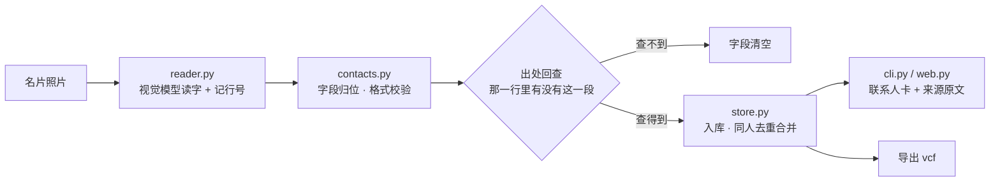

# Shika · Business Card to Contacts

[](https://github.com/wushiyi105-jpg/shika/actions) []() [](./LICENSE) [](https://codecov.io/gh/wushiyi105-jpg/shika)

A stack of business cards after a trip, and three months later nobody can tell who is who. Photographing them does not help either — a pile of photos in the album, and finding one person means flipping through them one by one.

Shika does something narrow: **one card photo in, one contact out**. Fields go into an address book that can be searched and exported to a phone.

Narrow in how the work is split: **the model only reads the characters; field mapping, format checks and duplicate merging all happen locally**. And every field has to say which line of the card it came from — the program then goes back to that line to check. If it is not there, it is not recorded.


## Why "source" has to exist

Vision models read business cards correctly the vast majority of the time. But the way they fail is nasty: they invent a phone number that looks completely real.

The card prints "138 0013 8000"; the model may return "13800138000" — correct. It may also return "13800138001" — one digit off. You save it, call six months later, get an empty number, and assume the person changed numbers.

So I have it do two things:

1. Read the characters on the card **line by line**, one string per line, no rewriting, no merging.
2. Report a `line` for each field, saying which line the value came from.

Then `verify_fields` takes that line number into the source text: **after stripping whitespace, normalising case and converting full-width to half-width, the value must actually appear on that line**. If it does not, it was a guess — the field is cleared and a note goes into the issues list.

A wrong line number, when the line does exist somewhere on the card, still passes — it miscounted a line, it did not invent content. That looseness is deliberate: line numbers are fragile, the value is what matters.

## One real run

`samples/card-1.jpg` is a 1200×800 photo of a business card (a fictional person, shot on a desk, slightly tilted, with shadow). `python -m shika read samples/card-1.jpg --lines` gives:

```
卡片上的字：
  0: 星野科技
  1: 林知远
  2: 产品总监
  3: 手机 138 0013 8000
  4: 邮箱 lin.zhiyuan@xingye.com
  5: 深圳市南山区科苑路8号12层

林知远（星野科技）
  职位：产品总监
  手机：13800138000
  邮箱：lin.zhiyuan@xingye.com
  地址：深圳市南山区科苑路8号12层

把握：high · 这是一张商务联系的名片
```

Six fields, all correct first time, zero source issues. `138 0013 8000` was normalised to `13800138000` locally — that step is **not the model's work**: the model copies the source verbatim, and local `normalize_phone` strips spaces and dashes, drops `+86` and the "手机" prefix. Keeping model work and formatting work apart is how you know whom to blame when something goes wrong.

## What the field layer actually does

`contacts.py` is a pile of pure functions, no network:

| Function | What it does | Why |
| --- | --- | --- |
| `normalize_phone` | Collapse to digits, drop `+86`/`0086`/`86` prefixes, cut extensions like `转 801` | Cards print numbers a dozen different ways |
| `is_mobile` | 11 digits starting `1[3-9]` | Tells a mobile from a landline |
| `normalize_email` | Lowercase, strip angle brackets, restore `(at)` and full-width ＠ to `@` | Cards print them that way to defeat scrapers |
| `clean_name` | Drop "先生/女士/总监", reject names containing a company or digits | The model occasionally puts the company into the name |
| `validate` | Email format, phone length, presence of name, presence of any contact | Hard problems, must pass before saving |
| `merge` | Empty yields to non-empty, short yields to long | A second reading of the same person must not overwrite the first |

One easy trap: the model sometimes puts a landline into `mobile`, sometimes the reverse. `normalize` handles it — an 11-digit mobile found in `tel` moves to `mobile`, a landline found in `mobile` moves to `tel`. Without that, the UI shows "手机：01088886666", which looks wrong.

## Same person, several cards

"Is this the same person" is decided in three steps: phone → email → company+name. Phone is the hardest, company+name the softest (same name at the same company is almost certainly one person).

On a hit it does not create a new record; it `merge`s: empty fields take the new value, non-empty ones keep the longer string ("星野科技（深圳）" over "星野科技"). Notes from both cards are joined with "；" and de-duplicated.

Every recognition also leaves its own `cards` row (source lines, fields, confidence, issues), so "which card did this number come from" is always answerable. That is what `show` is for.

## Data flow

How one piece of data moves between the modules:



## Quick start

```bash
git clone https://github.com/wushiyi105-jpg/shika.git && cd shika
cp .env.example .env      # fill in VISION_API_KEY (can be the same as LLM_API_KEY)

python -m shika read samples/card-1.jpg --lines    # just look, nothing saved
python -m shika add  samples/card-1.jpg            # read and save
python -m shika list
python -m shika export --vcf                        # import into the phone's address book
```

Start the Web UI:

```bash
python -m shika serve      # http://127.0.0.1:8773
```

Run in Docker (the container uses the default port 8773):

```bash
docker build -t shika .
docker run -p 8773:8773 shika
```

## 🤔 Why not just ask a general LLM

A general model can look at a card photo and say "this is Zhang San from Such-and-such". Shika adds the three things it cannot:

1. **Fields can be verified** — every field records which line of the card it came from, and the program checks that line before storing it; a mismatch means it is not saved. Chat models like to "helpfully" complete a company address or a phone number, and you end up believing the card said so.
2. **Reproducible results** — the model only reads characters; field mapping, format validation and merging several cards of one person all happen locally, so the same card yields the same contact twice.
3. **Contacts stay local** — a card is someone else's personal data; results sit in local SQLite and only an explicit `export --vcf` produces a file for your phone. The address book is never uploaded.
4. **Structured output** — one card in, one contact out, with fixed fields and vCard export. A chat reply is prose you would retype into your contacts.

## 🎯 Use cases

- **A pile of cards after a trade show**: feed them in one by one back at the hotel and have fields mapped automatically; search by company or industry the next day instead of scrolling the photo album.
- **Moving to a new phone**: import half a year of cards at once and `export --vcf` into a single file your phone can read.
- **Finding "the supply-chain person from last time"**: search by name, company or note, with the original photo still on this machine to check.

## 🗺 Roadmap

- **Batch import**: point at a directory, recognise each card and summarise, listing the failures separately.
- **Back-side notes**: accept a photo of the card's back and merge handwritten notes such as "talked about cold chain" into the note field.
- **Company name normalisation**: fold abbreviations and English names of the same company together for cleaner filtering.
- **Visible merge policy**: when one person has several cards, show which card overrode which and where each field came from.
- **CSV export**: alongside vCard, a CSV for spreadsheets or a CRM.

## ❓ FAQ

**Where do I get an API key?**
A vision model is needed: a multimodal key such as Zhipu's `glm-4.6v-flashx`, set as `VISION_API_KEY` in `.env` (a text-model key can be the same one). A text-only model cannot read images.

**Where is data stored, and is it uploaded?**
Card paths and recognition results live in local SQLite (default `data/shika.db`); a model call sends the current image only, not the address book.

**Does it work without a key?**
It cannot read new cards, only browse and export stored contacts. The image step cannot avoid a multimodal model.

**How do I switch models?**
Change `VISION_BASE_URL`, `VISION_MODEL` and `VISION_API_KEY` as in `.env.example`; field mapping logic is unaffected.

**Can it read handwritten cards?**
It can try, with lower accuracy. That is why every field cites its line, so a misread is visible during verification rather than silently saved.

## Commands

| Command | What it does |
| --- | --- |
| `read <图> [--lines] [--json]` | Recognise only, nothing saved |
| `add <图> [--lines]` | Recognise and save; same person merges automatically |
| `list [关键词]` | Address book; keyword matches name/company/phone/email |
| `show <id> [--lines]` | One person plus all their source cards |
| `export [--csv\|--vcf] [--out]` | Export, vCard by default |
| `rm <id>` / `stats` / `serve` | Delete a person (cards go too) / stats / start the Web UI |

## The Web UI

Drag an image in and it shows the recognition result first, **without saving automatically**. The page lists "what was read off the card" verbatim, and flags fields in red when something is wrong. You look, decide it is fine, then click "save to contacts".

That step is deliberate. Auto-saving looks smoother, but one wrong digit is something you notice three months later. Making it sit there for one glance costs a click and keeps wrong numbers out of the book.

## Design trade-offs

- **Zero third-party dependencies**, Python 3.10+ standard library. Pillow appears in exactly two places: shrinking images over 900KB, and generating the usage GIF during development.
- **If shrinking fails, send it as-is.** Not a valid image, or no Pillow in the environment — send the raw bytes and let the API complain. Locally declaring an odd byte stream "unreadable image" hides the real reason.
- **No contact details still saves, with a warning.** A card with only a name and company is genuinely useless, but it is at least a record; `validate` says plainly "not a single contact method, this card is unusable" without blocking it.
- **Deleting a person deletes the cards.** Cards are that person's evidence; keeping evidence with no person is pointless.
- **vCard 3.0.** Older, but iOS, Android and Outlook all take it.

## Tests

```bash
python -m unittest discover -s tests
```

100 cases, all offline. The vision endpoint is replaced by a double, the Web layer starts a real server on `port=0`.

The focus is the verification layer: value on the given line → pass; value not on that line but elsewhere → pass (a miscounted line is not an invention); value nowhere on the card → dropped and recorded; empty lines and empty values → ignored; nothing read at all → a specific reason. Plus six phone formats, four anti-scraper email formats, a company name mixed into the name field, the three merge paths for one person, and same name at different companies must not merge.

The sample image has tests too (`test_data_url_prefix` reads it, `test_big_file_falls_back_without_pillow` builds an oversized fake): the sample is part of the documentation, and the tests should know if it breaks.

## Configuration

`.env` (already in `.gitignore`):

```
LLM_API_KEY=...
VISION_API_KEY=...
VISION_BASE_URL=https://open.bigmodel.cn/api/paas/v4
VISION_MODEL=glm-4.6v-flashx
```

The vision channel has its own variables and falls back to `LLM_*` when unset. Works with any OpenAI-style multimodal `/chat/completions` endpoint.

---

Luo Zhizhi · 15071889700
