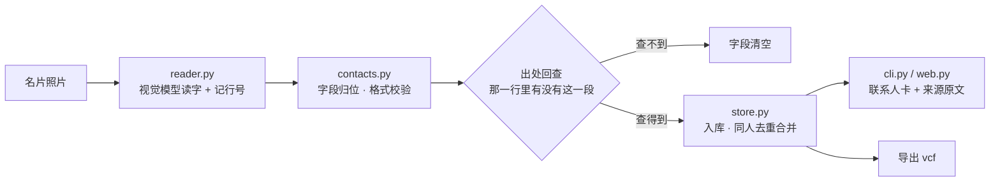

# 识卡 shika

[](https://github.com/wushiyi105-jpg/shika/actions) []() [](./LICENSE) [](https://codecov.io/gh/wushiyi105-jpg/shika)

出差回来一沓名片，摆三个月就分不清谁是谁。拍了照也没用——相册里一堆照片，找人还得一张一张翻。

识卡做的事很窄：**一张名片照片进去，一条联系人出来**。字段进通讯录，能搜、能导进手机。

窄的地方在于分工：**模型只负责把字读出来，字段归位、格式校验、重复合并全在本地**。而且每个字段都要交代它来自卡片上的第几行，程序回头去那一行核对——对不上就不记。


## 为什么非要「出处」

视觉模型读名片，绝大多数时候是对的。但它错的方式很讨厌：造一个看起来很像真的手机号。

名片上印着「138 0013 8000」，它可能给你「13800138000」——对的。也可能给你「13800138001」——差一位，你存进去，半年后打过去是空号，你还以为人家换号了。

所以我让它干两件事：

1. 先把卡片上的字**逐行**读出来，一行一个字符串，不改写不合并。
2. 每个字段报一个 `line`，说明这个值来自第几行。

然后 `verify_fields` 拿这个行号去原文里找：**去空白、统一大小写、全角转半角之后，这个值必须真的出现在那一行里**。找不到就是猜的，字段清空，问题清单里记一条。

行号报错了、但整张卡里确实有这行字，算通过——那是它数错了行，不是编了内容。这个宽松度是刻意的：行号是个很脆的东西，值本身才是要害。

## 真的跑了一遍

`samples/card-1.jpg` 是一张 1200×800 的商务名片照片（虚构人物，桌面上拍的，带点倾斜和阴影）。跑 `python -m shika read samples/card-1.jpg --lines`：

```
卡片上的字：
  0: 星野科技
  1: 林知远
  2: 产品总监
  3: 手机 138 0013 8000
  4: 邮箱 lin.zhiyuan@xingye.com
  5: 深圳市南山区科苑路8号12层

林知远（星野科技）
  职位：产品总监
  手机：13800138000
  邮箱：lin.zhiyuan@xingye.com
  地址：深圳市南山区科苑路8号12层

把握：high · 这是一张商务联系的名片
```

六个字段，一次全对，出处 0 个问题。`138 0013 8000` 被本地收成 `13800138000`——这一步**不是模型做的**，模型照原文抄，本地 `normalize_phone` 去空格去横线、剥 `+86`、剥「手机」前缀。模型和格式化的活分开，出问题时才知道该怪谁。

## 字段这一层在干什么

`contacts.py` 是一堆纯函数，不碰网络：

| 函数 | 干什么 | 为什么 |
| --- | --- | --- |
| `normalize_phone` | 收成纯数字，`+86`/`0086`/`86` 前缀剥掉，`转 801` 分机截掉 | 名片上的写法有十几种 |
| `is_mobile` | `1[3-9]` 开头 11 位 | 判断这是手机还是座机 |
| `normalize_email` | 小写、去尖括号、`(at)`／全角＠还原成 `@` | 名片上防爬虫都这么印 |
| `clean_name` | 去「先生/女士/总监」，含公司名或数字的丢弃 | 模型偶尔把公司名填进姓名 |
| `validate` | 邮箱格式、电话位数、有没有姓名、有没有联系方式 | 硬问题，存之前必须过 |
| `merge` | 空的让位给非空，短的让位给长的 | 同一个人第二次读到的卡不该覆盖第一次 |

有个容易踩的坑：模型有时把座机填进 `mobile`，有时反过来。`normalize` 里专门处理——11 位手机号出现在 `tel` 里就挪到 `mobile`，座机号出现在 `mobile` 里就挪到 `tel`。不挪的话，前端会显示「手机：01088886666」，看着就别扭。

## 同一个人多张卡

判断「是不是同一个人」按三级来：手机号 → 邮箱 → 公司+姓名。手机号最硬，公司+姓名最软（同名同公司，基本就是一个人）。

命中之后不新建，而是 `merge`：空字段用新的填，非空字段保留更长的那个（「星野科技」和「星野科技（深圳）」之间选后者）。两张卡的备注用「；」连起来，去重。

每次识别都会单独留一条 `cards` 记录（原文行、字段、把握、问题清单），所以「这条手机号是哪张卡读来的」永远查得到。`show` 命令就是干这个的。

## 数据流

一条数据在这几个模块之间怎么走：



## 快速开始

```bash
git clone https://github.com/wushiyi105-jpg/shika.git && cd shika
cp .env.example .env      # 填 VISION_API_KEY（可以和 LLM_API_KEY 一样）

python -m shika read samples/card-1.jpg --lines    # 只看，不入库
python -m shika add  samples/card-1.jpg            # 读并入库
python -m shika list
python -m shika export --vcf                        # 导进手机的通讯录
```

起网页：

```bash
python -m shika serve      # http://127.0.0.1:8773
```

## 命令

| 命令 | 做什么 |
| --- | --- |
| `read <图> [--lines] [--json]` | 只识别，不入库 |
| `add <图> [--lines]` | 识别并入库；同一人自动合并 |
| `list [关键词]` | 通讯录，关键词匹配姓名/公司/手机/邮箱 |
| `show <id> [--lines]` | 一个人 + 他的所有来源卡 |
| `export [--csv\|--vcf] [--out]` | 导出，默认 vCard |
| `rm <id>` / `stats` / `serve` | 删人（连卡一起删）/ 统计 / 起网页 |

## 网页

拖一张图进去，先出识别结果，**不自动存**。页面上会把「卡片上读到的字」原样列出来，字段有问题就红字标出。你看一眼、觉得没问题，再点「存进通讯录」。

这一步是我有意留的。自动存看起来更顺，但名片识别错一个数字，你三个月后才发现。让它先摆出来给你看一眼，成本是点一下鼠标，收益是错的号码进不了库。

## 设计取舍

- **零第三方依赖**，Python 3.10+ 标准库。Pillow 只在两种地方出现：压超过 900KB 的图，和开发期生成 GIF。
- **压图失败就原样发**。不是合法图片、或者环境里没装 Pillow，直接把原始字节发出去，让接口去报错。本地把一个奇怪的字节流解释成「图片打不开」，反而挡住了真实原因。
- **没联系方式也存，但会提醒**。只有姓名和公司的卡确实没用，可它至少是个记录；`validate` 会明说「一条联系方式都没有，这张卡等于用不上」，但不拦着。
- **删人连卡一起删**。卡是人的证据，人没了证据留着没有意义。
- **vCard 用 3.0**。老一点，但 iOS、Android、Outlook 都吃。

## 测试

```bash
python -m unittest discover -s tests
```

100 个用例，全离线。视觉接口被替身接管，Web 用 `port=0` 起真服务再打。

覆盖的重点在核验那一层：值在指定行 → 通过；值不在指定行但在别处 → 通过（行号数错不算编）；值整张卡都没有 → 丢弃并记录；空行空值 → 忽略；一个字都没读出来 → 单独给理由。还有电话的六种写法、邮箱的四种防爬写法、姓名里混进公司名、同一个人三种合并路径、同名不同公司不许合并。

样例图本身也有测试（`test_data_url_prefix` 读它、`test_big_file_falls_back_without_pillow` 造一个超大假文件）：样例是文档的一部分，它哪天坏了测试得知道。

## 配置

`.env`（已在 `.gitignore` 里）：

```
LLM_API_KEY=...
VISION_API_KEY=...
VISION_BASE_URL=https://open.bigmodel.cn/api/paas/v4
VISION_MODEL=glm-4.6v-flashx
```

视觉通道单独一套变量，没配就退回 `LLM_*`。兼容任何 OpenAI 风格的多模态 `/chat/completions` 接口。

---

作者：shiyi
邮箱：wushiyi105@gmail.com
GitHub：[wushiyi105-jpg](https://github.com/wushiyi105-jpg)
